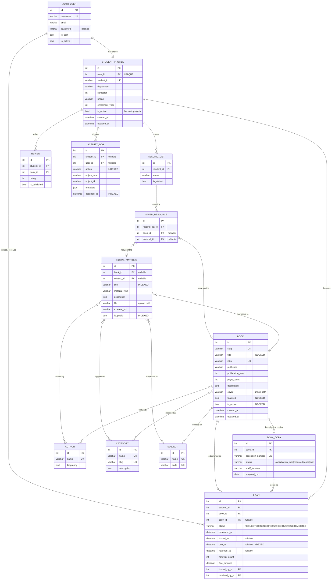
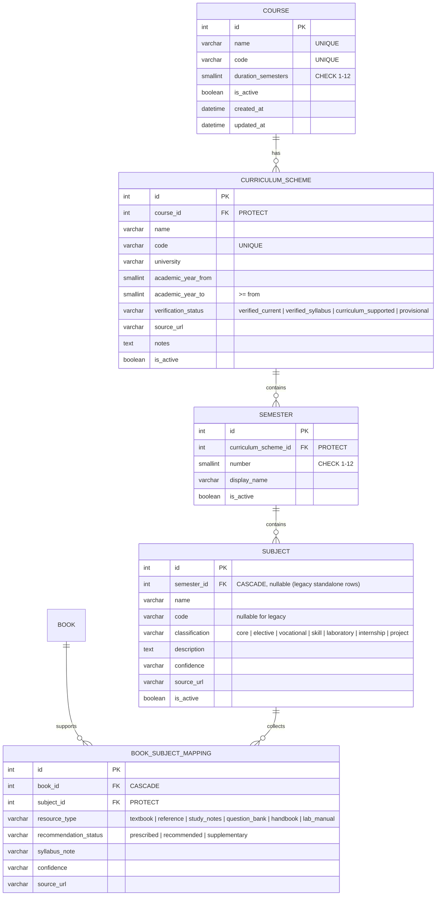

# LibTrack — Database Schema

All tables live in the `core` Django app and are created by the migrations in
`core/migrations/`. The runtime database is **MySQL**; a local SQLite fallback
exists only so the project can be demonstrated without a database server.

---

## 1. Entity relationship diagram


```

### 1a. Academic structure (added with the curriculum layer)



**Academic integrity rules**

- `UNIQUE (curriculum_scheme, number)` — a scheme has each semester once.
- `UNIQUE (semester, code)` and `UNIQUE (semester, name)` — subject identity
  is scoped to its semester.
- Standalone legacy subjects (the four original browse areas) keep global
  uniqueness via partial unique constraints on `name`/`code` where
  `semester IS NULL`.
- `CHECK` — a scheme subject must carry a code.
- `CHECK` — `academic_year_to >= academic_year_from` (or either null).
- `CHECK` — course duration between 1 and 12.
- `UNIQUE (book, subject)` on mappings — a book supports a subject once; a
  book supporting several subjects means several mapping rows, never a
  duplicated bibliographic record.
- `Subject` delete is **PROTECT**ed while book mappings reference it, and
  `Semester`/`CurriculumScheme`/`Course` are PROTECTed while they contain
  structure, so borrowing history and curated mappings can never be silently
  destroyed. `is_active` flags provide archival instead.

---

## 2. Tables in words

| Table | Purpose | Rows are protected by |
|---|---|---|
| `auth_user` | Django's built-in login table (salted password hash) | — |
| `core_studentprofile` | Academic details hanging off a user | — |
| `core_author` | One writer, referenced many times | — |
| `core_category` | Subject area shown in catalogue filters | — |
| `core_subject` | Catalogue subject; legacy standalone rows or one semester of a scheme | — |
| `core_course` | Academic programme the collection is curated for (BCA) | `PROTECT` from schemes |
| `core_curriculumscheme` | One regulation under which a course runs, with verification status | `PROTECT` from semesters |
| `core_semester` | One semester inside a scheme | `PROTECT` from subjects |
| `core_booksubjectmapping` | Places a book on a subject's reading list (type + status + confidence) | `PROTECT` from subject; `CASCADE` from book |
| `core_book` | **Bibliographic record** — title, ISBN, publisher, year, cover | `PROTECT` from copies and loans |
| `core_bookcopy` | **One physical copy** — accession number, shelf, status | `PROTECT` from loans |
| `core_loan` | **One borrowing event** — the borrow record | `PROTECT` from student, book, copy |
| `core_digitalmaterial` | Notes, papers, e-books (upload or external URL) | — |
| `core_readinglist` | A student's saved-items list | `CASCADE` from student |
| `core_savedresource` | A book or material inside a reading list | `CASCADE` from list |
| `core_review` | A student's rating and review | `CASCADE` from student and book |
| `core_activitylog` | Audit trail of every action | `SET NULL` (log survives) |

### Primary keys
Every table uses Django's `BigAutoField` named `id`. It is an auto-incrementing
integer, so it is compact, fast to index and never reused.

### Foreign keys and delete behaviour

| Relationship | `on_delete` | Why |
|---|---|---|
| `StudentProfile.user` | `CASCADE` | Deleting the login removes the student record too. |
| `BookCopy.book` | `PROTECT` | A book with physical copies cannot be silently erased. |
| `Loan.student` / `Loan.book` / `Loan.copy` | `PROTECT` | Borrowing history must survive. |
| `DigitalMaterial.book` / `.subject` | `SET_NULL` | Removing a title should not delete a resource. |
| `ReadingList.student`, `SavedResource.reading_list` | `CASCADE` | Purely owned by the student. |
| `ActivityLog.student` / `.user` | `SET_NULL` | The audit trail outlives the account. |

### Many-to-many relationship tables
`Book ↔ Author`, `Book ↔ Category`, `DigitalMaterial ↔ Category`,
`DigitalMaterial ↔ Author` are many-to-many. Django creates join tables
(`core_book_authors`, `core_book_categories`, …). A book can have several
authors (a textbook has three) and several categories, while an author can
appear in many books — this is exactly what a junction table is for.

---

## 3. Integrity rules enforced in the database

These are `CHECK` constraints and `UNIQUE` constraints, so the database itself
refuses bad data even if a view forgets to validate:

| Rule | Where |
|---|---|
| `due_at` is never earlier than `issued_at` | `loan_due_after_issue` |
| `returned_at` is never earlier than `issued_at` | `loan_return_after_issue` |
| A fine is never negative | `loan_fine_nonnegative` |
| A review rating is between 1 and 5 | `review_rating_1_to_5` |
| A student's semester is 1–12 | `student_semester_1_to_12` |
| A digital material has a file **or** a URL | `material_has_a_source` |
| A saved resource points at a book **or** a material, not both/neither | `saved_resource_one_target` |
| ISBN, student number, accession number, slug, category name are unique | `unique=True` |

Indexes were added to every field used in a search or filter:
`Book(title)`, `Book(is_active)`, `Book(featured)`, `BookCopy(book, status)`,
`Loan(student, status)`, `Loan(status, due_at)`, `Loan(book, status)`,
`Loan(created_at)`, `StudentProfile(department, semester)`,
`DigitalMaterial(material_type, is_public)`, `ActivityLog(action, occurred_at)`.

---

## 4. Normalization

The schema is in **Third Normal Form (3NF)**.

**1NF — atomic values.** Every column holds one value. A book does not store
`"A. Silberschatz, Henry Korth, S. Sudarshan"` in an `author` column; the
authors live in `core_author` and are joined through a junction table. There
are no repeating groups such as `copy1_status, copy2_status`.

**2NF — no partial dependency.** In `core_bookcopy`, the primary key is `id`
(a surrogate). `accession_number` is a candidate key. Every non-key column
(`status`, `shelf_location`, `acquired_on`) depends on the *whole* key, not on
part of a composite key, so there is no partial dependency to violate.

**3NF — no transitive dependency.** Non-key columns depend only on the key, not
on other non-key columns. For example, a student's course and semester depend
on `StudentProfile`, not on `User`. Publisher name is stored once on `Book` and
is not re-stored per copy.

**Deliberate denormalisation: none.** There is no cached `available_copies`
column. Availability is *derived* from `BookCopy.status`:

```python
@property
def available_copies(self):
    return self.copies.filter(status=BookCopy.Status.AVAILABLE).count()
```

This means the number physically cannot drift out of step with the copies, and
it can never go negative. A cached counter would be faster but would need
trigger-like logic in every code path — a classic source of data corruption.

---

## 5. Table relationships summary

```
User 1 ─── 0..1 StudentProfile
StudentProfile 1 ─── * Loan
StudentProfile 1 ─── * ReadingList 1 ─── * SavedResource
StudentProfile 1 ─── * Review
StudentProfile 1 ─── * ActivityLog

Book * ─── * Author
Book * ─── * Category
Book * ─── 0..1 Subject
Book 1 ─── * BookCopy 1 ─── * Loan
Book 1 ─── * Loan

DigitalMaterial * ─── * Category
DigitalMaterial * ─── * Author
DigitalMaterial * ─── 0..1 Book
DigitalMaterial * ─── 0..1 Subject
```
